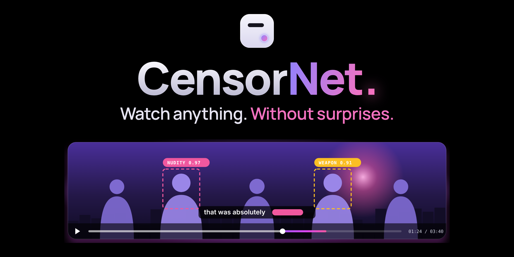
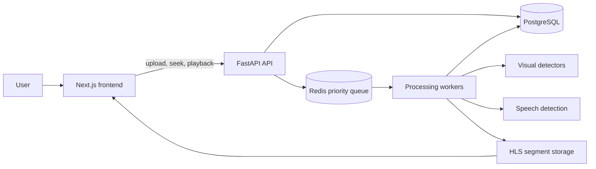
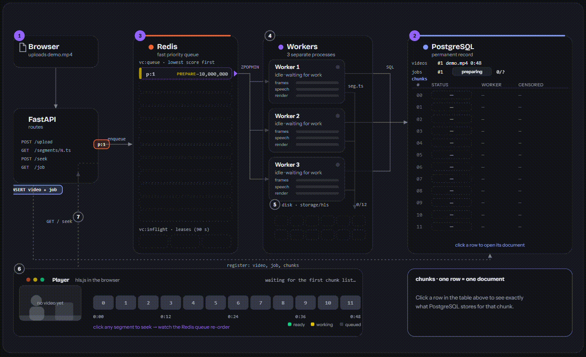

<p align="center">
  
</p>

<p align="center">
  <b>Detects sensitive visuals and language as your video plays.</b>
</p>

<p align="center">
  <a href="https://drive.google.com/drive/u/1/folders/1cizp-PJzEeS3z8CStZZUOpFcHRiYNMQR">
    
  </a>
</p>

<p align="center">
  
  
  
  
  
</p>

<p align="center">
  <a href="#what-it-does">What it does</a> &nbsp;·&nbsp;
  <a href="#how-it-censors">Pipeline</a> &nbsp;·&nbsp;
  <a href="#architecture">Architecture</a> &nbsp;·&nbsp;
  <a href="#quick-start">Quick start</a> &nbsp;·&nbsp;
  <a href="#how-work-is-prioritised">Priorities</a> &nbsp;·&nbsp;
  <a href="#configuration">Configuration</a>
</p>

---

CensorNet is a real-time video censorship platform. Upload a video or paste a YouTube URL and it
starts building a safer HLS stream right away, without waiting for the whole video to finish
processing.

The video is split into short chunks. Each chunk is scanned for sensitive visuals and spoken
profanity, censored where needed, and queued by how close it is to the viewer's current playback
position. You can start watching while the rest of the video is still being worked on.

In short:

- **Blur** only the detected regions, not the whole frame
- **Beep** English and Hindi/Hinglish profanity, word by word
- **Follow** the playhead, so the queue reacts to every seek
- **Audit** everything: detections, attempts and workers are all recorded

## What it does

- Upload an MP4 or submit a YouTube URL
- Start watching as soon as the first processed segment is ready
- Jump to any point in the timeline and that part gets processed first
- See the processing status of every chunk
- Review what was detected: labels, timestamps, bounding boxes and beeped words
- Play a stream where visual detections are blurred and profanity is beeped

### Why bother

Long videos don't have to be fully processed before playback starts. If you seek to a different
scene, the queue shifts to that scene. Less waiting, more control.

For anyone thinking about this as a product:

- Lower time to first playback, since the first segments are served early
- Targeted moderation: blur regions, not entire frames
- Compute follows demand, because playback position decides what runs next
- Auditable, with detections, audio events, attempts and workers stored
- Resilient: Redis coordinates work, PostgreSQL is the permanent record
- Extensible: detectors, thresholds, profanity lists and priorities are all configurable

## How it censors

| Input | Detection / processing | Output |
| --- | --- | --- |
| Video frames | NudeNet for nudity, YOLO for weapons, red-region analysis gated by a violence classifier for blood | Blur only the detected regions |
| Audio | faster-Whisper transcription checked against the configured English and Hindi/Hinglish profanity list | Matching words replaced with a beep |
| Playback request | HLS playlist and segment availability check | Requested chunk is boosted so it's processed next |

Chunk lifecycle:

```text
pending -> processing -> completed
                    \-> failed
```

Each chunk is decoded, analysed, rendered, encoded as an MPEG-TS HLS segment and recorded in
PostgreSQL. **A failed chunk is never served uncensored.** After the configured retry limit it
returns an error until it's retried.

## Architecture



| Component | Responsibility |
| --- | --- |
| Next.js frontend | Upload flow, job status, HLS playback, chunk progress, interactive architecture visualisation |
| FastAPI backend | Upload and YouTube ingestion, job lifecycle, HLS playlists and segments, seek handling, operational endpoints |
| Redis | Disposable priority queue, worker leases and heartbeats |
| PostgreSQL | Permanent records: videos, jobs, chunks, detections, audio events, attempts, processing times |
| Workers | Load the detection models once, then process chunks independently |
| FFmpeg + storage | Extract frames/audio and write finished HLS segments atomically |

> Redis is disposable on purpose. If it gets cleared, the reaper rebuilds pending work from
> PostgreSQL, which is the durable record of what happened.

### Interactive architecture animation

[](v2/frontend/app/architecture/page.tsx)

The diagram above is also a live animation in the frontend. Run it and open
`http://localhost:3000/architecture` for the full interactive version.

- The homepage shows a read-only version that starts on its own at `1x`
- `/architecture` adds play/pause, restart, speed controls, timeline seeking, PostgreSQL row
  inspection, priority info and an event log
- Moving packets stand for simulated upload, queue, worker, database and playback events (one
  block per packet, no ghost trails)
- It pauses when off-screen, when the tab is hidden, or when you pause it, and it respects
  `prefers-reduced-motion`
- It's a deterministic explainer of the backend design. It doesn't process a real video.

Code lives in `v2/frontend/lib/arch/engine.ts`, `v2/frontend/lib/arch/useSimulation.ts`, and the
SVG diagram and packet layer in `v2/frontend/components/architecture/`.

## Quick start

**You'll need:** Python 3.10+, Node.js 18+, FFmpeg and FFprobe on `PATH`, Docker Desktop, and
enough memory for the detection models and worker count you pick.

**1. Start PostgreSQL and Redis** (from `v2/`)

```powershell
docker compose up -d
```

**2. Install and configure the backend**

```powershell
cd v2\backend
python -m venv .venv
.\.venv\Scripts\Activate.ps1
pip install -r requirements.txt
copy .env.example .env
python check_setup.py
```

The first worker start may download the configured Whisper, YOLO and violence-classifier models.
For GPU, install the matching CUDA build of PyTorch and set `DEVICE=cuda` in `backend/.env`.

**3. Install and run the frontend** (separate terminal)

```powershell
cd v2\frontend
npm install
npm run dev
```

**4. Run the API and workers** (terminals with the backend venv active)

```powershell
cd v2\backend
uvicorn app.main:app --port 8000
```

```powershell
cd v2\backend
python run_workers.py -n 3
```

Open http://localhost:3000, upload a video and open the generated video page.
Health check: `http://localhost:8000/health`.

<details>
<summary><b>Repository structure</b></summary>

```text
CensorNet/
├─ v2/                         Current full-stack implementation
│  ├─ backend/
│  │  ├─ app/
│  │  │  ├─ models/            SQLAlchemy database models
│  │  │  ├─ routes/            Video, job, and chunk API routes
│  │  │  ├─ schemas/           Pydantic request/response schemas
│  │  │  ├─ services/          Queue, detection, audio, rendering, and storage logic
│  │  │  └─ workers/           Worker process entry point
│  │  ├─ tests/                Backend tests
│  │  ├─ requirements.txt      Python dependencies
│  │  └─ run_workers.py        Start workers in one terminal
│  ├─ frontend/
│  │  ├─ app/                  Next.js routes and global styles
│  │  ├─ components/
│  │  │  ├─ architecture/      Interactive architecture visualisation
│  │  │  ├─ home/              Homepage sections and animation preview
│  │  │  ├─ layout/            Navigation and footer
│  │  │  ├─ upload/            File and YouTube input components
│  │  │  └─ video/             Player, buffer, job, and chunk components
│  │  └─ lib/                  API client, status helpers, and simulation engine
│  ├─ docker-compose.yml       PostgreSQL and Redis
│  └─ README.md                Detailed v2 operational notes
└─ v1/                         Earlier frontend/backend implementation
```

</details>

## How work is prioritised

Chunks closer to the playhead get higher priority:

| Tier | Purpose |
| --- | --- |
| `STALL` | The exact segment currently blocking playback |
| `URGENT` | The playhead chunk and the configured prefetch window |
| `AHEAD` | Future chunks, nearest first |
| `BEHIND` | Already-watched chunks, handy if the viewer seeks back |

Workers take work from Redis and then claim the chunk atomically in PostgreSQL, so two workers
never process the same chunk. Leases and heartbeats let abandoned work get requeued if a worker
dies unexpectedly.

## Configuration

Settings live in `v2/backend/.env.example`. The ones you'll most likely touch:

| Setting | Controls |
| --- | --- |
| `ANALYZER` | Which visual and audio analysers are enabled |
| `CHUNK_SECONDS` | Chunk duration and seek granularity |
| `ANALYSIS_FPS` | Visual sampling rate |
| detector thresholds | Sensitivity and false positives |
| `WHISPER_MODEL` | Speech-recognition model size |
| `PREFETCH_CHUNKS` | How much work is prepared ahead of the playhead |
| `WORKER_COUNT` + lease settings | Processing capacity and recovery behaviour |

## Testing

```powershell
# backend tests
cd v2\backend
pytest -q

# frontend production build
cd v2\frontend
npm run build
```

## Current scope

CensorNet processes uploaded videos and YouTube sources. It does not ingest live RTMP or camera
feeds yet, though the chunk, queue and worker design could be extended to support that later.

<p align="center">
  <br />
  <sub>Watch anything. Without surprises.</sub>
</p>